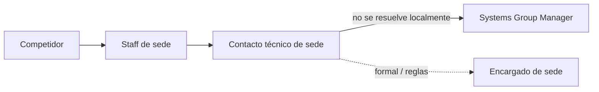
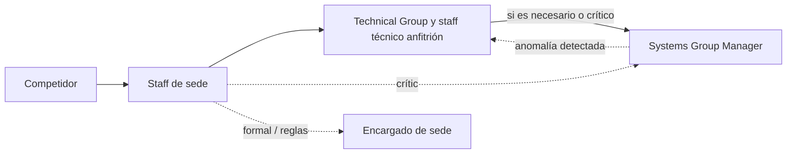

# Preguntas frecuentes técnicas — Sedes y MaratonaLinux

<!-- FAQ técnica: se publica en /faq/tecnica/. Mismo formato que faq-tcp-icpc.md: "# Grupo", "## Sección", **Pregunta** en su propia línea y la respuesta debajo. El texto de una sección antes de su primera pregunta se muestra como introducción. Organizada según el recorrido de una sede: conceptos, requisitos, antes, durante y después de la competencia. -->

# Resumen

## TCP y Regional ICPC de un vistazo

Las dos competencias usan el mismo ambiente, pero la sede cumple un rol distinto en cada una.

| | TCP | Regional ICPC |
|---|---|---|
| **Sedes** | Varias sedes en el país, en simultáneo | Una sede en Chile, que por lo general cambia cada año |
| **Quién opera el ambiente durante la competencia** | El contacto técnico de cada sede | El Systems Group Manager y el Technical Group de ICPC Chile, con el staff técnico anfitrión |
| **Sistema de competencia** | [MOJ](#sistema-de-competencia-moj), administrado por cada sede | [MOJ](#sistema-de-competencia-moj), administrado por el equipo de sistemas de ICPC Latinoamérica |
| **Contacto técnico de sede** | Valida, prepara, opera, da soporte y libera los equipos | Solo valida y prepara; no recibe credenciales |
| **Staff técnico anfitrión** | No aplica | Mínimo 1 persona por cada 15 equipos en cada sala; ideal 2 a 3 |
| **WiFi** | Permitido | No: solo red por cable |
| **Máquinas de respaldo** | Al menos 2 | Mínimo 5; se recomienda el 10% de los computadores si es mayor |
| **Monitoreo** | Contactos técnicos, Systems Group Manager y Systems Group | Systems Group Manager y equipo de sistemas de ICPC Latinoamérica |
| **Escalamiento** | Staff de sede → contacto técnico → Systems Group Manager | Staff de sede → Technical Group → Systems Group Manager; los problemas críticos, directo al Systems Group Manager |
| **Impresora e insumos de oficina** | Opcionales | Obligatorios: al menos una impresora |
| **Liberación de equipos** | Contacto técnico de sede | Staff técnico anfitrión |

## Checklist de la sede

**Apenas se confirma la sede**:
- Designar al contacto técnico de sede y, en el Regional ICPC, al [staff técnico anfitrión](#que-es-el-staff-tecnico-anfitrion).
- Revisar con el área de TI los [requisitos de los computadores](#que-requisitos-deben-cumplir-los-computadores) y de la [red](#que-red-debe-proveer-la-sede). Si algo no se puede cumplir, [informarlo con anticipación](#que-pasa-si-la-sede-no-puede-cumplir-algun-requisito-tecnico).
- Generar la [prueba técnica](#como-se-genera-la-prueba-tecnica) en los modelos de computador que se usarán.

**Semana previa**:
- En el TCP: recibir las credenciales y configurar la imagen de la sede.
- Instalar MaratonaLinux en los puestos de competencia, las [máquinas de respaldo](#cuantas-maquinas-de-respaldo-se-necesitan) y las estaciones de staff ([idealmente una semana antes; como mínimo, una máquina semilla](#con-cuanta-anticipacion-conviene-preparar-los-computadores)).
- Mantener la máquina semilla actualizada; como mínimo, actualizarla el día antes de la competencia.
- Probar el ambiente con la [imagen de prueba](#puedo-probar-el-sistema-antes).
- En el TCP: confirmar que llegaron los [tres correos de MOJ](#que-correos-llegan-antes-de-la-competencia) (plataforma, credenciales y anuncio), [generar las credenciales de todos los equipos](#quien-genera-las-credenciales-de-los-equipos) y [probar el acceso a MOJ](#como-se-verifica-que-los-equipos-pueden-acceder-a-moj). En el Regional ICPC, MOJ lo prepara el equipo de sistemas de ICPC Latinoamérica, no la sede.

**Día de la competencia**:
- Estar presentes desde el warmup hasta el cierre.
- Ante un problema, seguir la [cadena de escalamiento](#escalamiento) de la competencia.

**Después de la competencia**:
- [Liberar los equipos](#como-se-deja-el-computador-como-estaba-despues-de-la-competencia) e informar los incidentes.

# Roles y personas

## Organización

La parte técnica de una competencia se organiza en tres niveles, que trabajan coordinados entre sí. Sistemas opera de forma separada de la dirección de sede: en Chile, el Systems Group trabaja aparte, colaborando con la dirección de la competencia (Chile Site Director).

- **ICPC Latinoamérica:** los mantenedores de MaratonaLinux, el sistema de competencia ([MOJ](https://moj.naquadah.com.br/), que usan el TCP y el Regional ICPC) y el equipo de sistemas que monitorea el Regional ICPC.
- **ICPC Chile (la sede Chile):** el **Systems Group**, a cargo de los aspectos técnicos y de soporte, dirigido por el Systems Group Manager. Dentro del Systems Group está el **Technical Group**, dedicado al soporte durante la competencia.
- **Cada sede anfitriona:** el contacto técnico de sede y, en el Regional ICPC, el staff técnico anfitrión, que forma parte del staff de la sede.

Esta división de roles es propia de la sede Chile. Otras sedes de ICPC Latinoamérica pueden tener su propia organización y su propia división de roles y funciones.

| Rol | Nivel | Competencia | Qué hace y con quién se coordina |
|---|---|---|---|
| **Sistemas de ICPC Latinoamérica** | ICPC Latinoamérica | Ambas | Mantienen MaratonaLinux y el sistema de competencia. En el Regional ICPC, su equipo de sistemas también monitorea los computadores. Se coordinan con el Systems Group Manager. |
| **Systems Group Manager** | ICPC Chile | Ambas, todo el año | Dirige el Systems Group. Está a cargo de los aspectos técnicos y de soporte, y de la coordinación con las sedes anfitrionas (en el TCP y el Regional ICPC), con los mantenedores y con otras sedes, no solo durante la competencia. También da [apoyo y orientación todo el año](#apoyo-todo-el-anio). |
| **Technical Group** | ICPC Chile (parte del Systems Group) | Regional ICPC | Es el equipo de soporte en terreno del Systems Group Manager: actúa durante la ejecución de la competencia de forma directa y ágil, sin los trámites propios del Systems Group, y coordina al staff técnico anfitrión. En el TCP no hay Technical Group. |
| **Contacto técnico de sede** | Sede anfitriona | Ambas, con un rol distinto | En el TCP prepara, opera y libera los equipos, con línea directa con el Systems Group Manager. En el Regional ICPC solo valida y prepara. |
| **Staff técnico anfitrión** (Technical Group – Host) | Sede anfitriona (parte del staff de la sede) | Regional ICPC | Se integra al Technical Group: son sus ojos en cada sala, hacen la primera respuesta cuando se les indica y liberan los equipos al final. |

## Contacto técnico de sede

**¿Qué es el contacto técnico de sede?**
Es la persona designada por la sede como punto de contacto con el Systems Group Manager para todo lo relacionado con el ambiente de competencia (MaratonaLinux) y la infraestructura de su sede. Tanto el TCP como el Regional ICPC necesitan uno, pero su rol cambia:

- **En el TCP:** prepara, opera y da soporte al ambiente de competencia en su sede, desde la validación de la infraestructura, semanas antes, hasta la liberación de los equipos al final.
- **En el Regional ICPC:** valida la infraestructura y deja los computadores listos: que arranquen, que cumplan los requisitos, que la red funcione y que MaratonaLinux quede instalado. No recibe credenciales, y durante la competencia el ambiente está a cargo del Systems Group Manager y del Technical Group de ICPC Chile. Se necesita porque la sede es quien conoce sus computadores y su red. Ver [¿Qué hace el contacto técnico de sede en el Regional ICPC?](#que-hace-el-contacto-tecnico-de-sede-en-el-regional-icpc).

No es el mismo rol que el **encargado de sede**, que responde por lo formal: recibir a los equipos, custodiar el problemset, hacer cumplir las reglas y, si corresponde, descalificar. Una misma persona puede cumplir ambos roles, pero son responsabilidades distintas.

La sede debe informar quién será su contacto técnico de sede, tanto en el TCP como en el Regional ICPC.

**¿Qué perfil se recomienda para el contacto técnico de sede?**
Una persona con acceso administrativo a los computadores del laboratorio (BIOS, particiones) y que pueda gestionar cambios de red con el área de TI de su institución (DHCP, NAT, excepciones de firewall). Idealmente es el técnico del laboratorio. No necesita ser académico.

**¿Qué hace el contacto técnico de sede en el TCP?**

| Etapa | Qué hace |
|---|---|
| **Validación** (apenas se confirma la sede) | Prueba la infraestructura con la [imagen genérica de registro de sede](https://github.com/maratona-linux/maratona-linux/wiki/Registro-de-sede) en los modelos de computador que se usarán, y reporta el resultado al Systems Group Manager. Esta prueba detecta a tiempo los problemas de red, firewall o DHCP. |
| **Recepción de credenciales** | Recibe del Systems Group Manager el acceso a la consola de administración de MaratonaLinux de su sede, para preparar los computadores, y mantiene esas credenciales confidenciales: no las comparte fuera de su equipo técnico. Se une al grupo de Telegram de asistencia técnica. |
| **Preparación** (semana previa) | Configura la imagen de la sede (zona horaria, teclado, fondo). Prepara varios USB de arranque e instala el ambiente en todos los puestos de competencia, en al menos 2 máquinas de respaldo y en las estaciones de staff (impresión y tareas generales). Asigna nombre o ubicación a cada máquina en la consola de administración, porque por defecto se identifican por MAC. |
| **Día de la competencia** | Está presente durante todo el período. Ante una falla, reinicia o reemplaza el equipo afectado con una máquina de respaldo; la meta es resolverlo en menos de 5 minutos. Avisa al Systems Group Manager por el canal de coordinación. |
| **Cierre** | Libera el espacio de los computadores con los mismos USB de arranque. Si hubo incidentes, informa al Systems Group Manager qué máquina falló (MAC o ubicación) y a qué hora, para el análisis posterior. |

**¿Qué hace el contacto técnico de sede en el Regional ICPC?**
Solo valida y prepara, junto al [staff técnico anfitrión](#que-es-el-staff-tecnico-anfitrion). No recibe credenciales, y durante la competencia el ambiente queda a cargo del Systems Group Manager y del Technical Group de ICPC Chile.

| Etapa | Qué hace |
|---|---|
| **Validación** (apenas se confirma la sede) | Prueba la infraestructura con la [imagen genérica de registro de sede](https://github.com/maratona-linux/maratona-linux/wiki/Registro-de-sede) en los modelos de computador que se usarán, y reporta el resultado al Systems Group Manager. Informa qué computadores y qué red tiene la sede. |
| **Preparación** (antes de la competencia) | Deja los computadores listos según los [requisitos](#que-requisitos-deben-cumplir-los-computadores): que arranquen desde pendrive, con SecureBoot deshabilitado, espacio libre en una partición y red por cable con DHCP (en el Regional ICPC no se permite WiFi). Coordina con el área de TI de su institución los cambios de red necesarios. Junto al staff de sede, instala MaratonaLinux en los computadores de la competencia y en las [máquinas de respaldo](#cuantas-maquinas-de-respaldo-se-necesitan). |

## Staff técnico anfitrión

**¿Qué es el staff técnico anfitrión?**
Es el personal adicional que la sede anfitriona del Regional ICPC aporta para integrarse al Technical Group como anfitrión (Technical Group – Host). Apoya la preparación y también la operación durante la competencia: en cada sala, son los ojos del Technical Group y del Systems Group Manager.

El contacto técnico de sede forma parte del staff técnico anfitrión y cuenta para la cantidad mínima.

**¿Cuál es el rol del staff técnico anfitrión durante la competencia?**
Cada persona queda asignada a un espacio (laboratorio o sala) y es el primer contacto técnico en él:
- Observa la sala para detectar problemas a tiempo: un equipo que levanta la mano, una pantalla congelada o un computador sin red.
- Reporta cada incidente al Technical Group por el canal de coordinación.
- Hace la primera respuesta cuando el Technical Group o el Systems Group Manager se lo indican.
- Registra cada incidente: puesto o equipo, máquina (MAC o ubicación), síntoma y hora.
- No interviene en temas formales ni de reglas: esos van al encargado de sede.

**¿Qué hace el staff técnico anfitrión?**

| Etapa | Qué hace |
|---|---|
| **Preparación** (días previos) | Junto al contacto técnico de sede, instala MaratonaLinux en los computadores de la competencia y verifica que cada puesto arranque y tenga red. Conoce la distribución de su sala y la ubicación de las máquinas de respaldo. |
| **Día de la competencia** (incluye warmup y cierre) | Está presente en su sala durante todo el día. Observa la sala y reporta al Technical Group y al Systems Group Manager cualquier problema técnico. Hace la primera respuesta cuando se le indica, como reiniciar un equipo o reemplazarlo por una máquina de respaldo. Si el problema es crítico, puede escalarlo directamente al Systems Group Manager. |
| **Liberación de equipos** (al terminar la competencia) | Libera el espacio de los computadores con los USB de arranque, para dejarlos como estaban. |

**¿Cuántas personas de staff técnico anfitrión debe aportar la sede?**
Solo en el Regional ICPC. Se calcula por cada espacio delimitado (laboratorio o sala) donde se compite:

- **Mínimo:** una persona por cada 15 equipos del espacio, redondeando hacia arriba (hasta 15 equipos, 1 persona; de 16 a 30, 2; de 31 a 45, 3).
- **Ideal:** entre dos y tres personas por espacio.

Por ejemplo, si la competencia se realiza en dos laboratorios, uno con 20 equipos y otro con 10, el mínimo es 2 personas en el de 20 y 1 en el de 10: 3 en total. Lo ideal sería 2 a 3 en cada laboratorio. El contacto técnico de sede cuenta dentro de estas cifras.

**¿Quién puede ser parte del staff técnico anfitrión?**
Cualquier persona de la institución anfitriona, sea personal o estudiante, siempre que no sea competidor ni coach de un equipo en la competencia.

**¿Qué requisitos debe cumplir el staff técnico anfitrión?**
- Estar dispuesto y en condiciones de cargar equipos computacionales de hasta 5 kg.
- Deseable: conocimientos de Linux a nivel de usuario intermedio, para detectar problemas durante la competencia (ver [qué significa](#que-se-considera-un-usuario-intermedio-de-linux)).
- Disponibilidad durante los días de preparación previos y todo el día de la competencia (warmup, competencia, cierre y liberación de los equipos); como mínimo, durante el warmup y la competencia.
- Contar con la aprobación del contacto técnico de la sede.

**¿Qué se considera un usuario intermedio de Linux?**
Una prueba rápida: si puede instalar una distribución de Linux en su propio computador, conectarse a una red WiFi desde la terminal y explicar por qué un programa no abre, tiene el nivel.

Como ejemplo, alguien que puede hacer lo siguiente sin ayuda:

- **Moverse por el sistema:**
  - usar la terminal: cambiar de carpeta (`cd`, `ls`), leer archivos (`cat`, `less`) y buscar (`grep`, `find`);
  - entender usuarios y permisos: qué hace `sudo` y por qué un archivo no se puede abrir;
  - reconocer una sesión gráfica congelada y pasar a una consola de texto (Ctrl+Alt+F2).
- **Diagnosticar un computador que falla:**
  - procesos: ver qué está corriendo y qué consume CPU o memoria (`top` o `htop`), y detener un programa colgado (`kill`);
  - disco: revisar el espacio libre (`df -h`), porque un disco lleno hace fallar cosas sin avisar;
  - red: revisar si el computador tiene IP y enlace (`ip a`, las luces del cable), probar la conectividad (`ping`) y distinguir entre «sin red» y «con red pero sin internet»;
  - hardware: revisar si un periférico se detecta (`lsusb`) y reconocer, por la pantalla de arranque, si el computador quedó en la BIOS, en el gestor de arranque o en el escritorio.
- **Reportar con claridad:**
  - describir el problema con precisión: «puesto 14, sin red, el cable tiene luz, `ip a` no muestra IP», y no solo «no anda»;
  - obtener la dirección MAC del computador (`ip link`) cuando se le pida.

No se necesita administrar servidores, programar scripts, compilar software ni configurar redes: basta con detectar que algo anda mal y describirlo bien, porque las soluciones las aplica el Technical Group.

**¿Cómo se informa el staff técnico anfitrión?**
Solo en el Regional ICPC. El contacto técnico de sede lo informa al Systems Group Manager al menos una semana antes de la competencia, con el nombre y el contacto de cada persona y el espacio (laboratorio o sala) al que se asigna.

# Requisitos de la sede

## Computadores

**¿Qué pasa si la sede no puede cumplir algún requisito técnico?**
Tanto en el TCP como en el Regional ICPC, la sede debe informarlo al [Systems Group Manager](#a-quien-contacto-si-tengo-dudas-tecnicas) apenas lo detecte, antes de la competencia. Así hay tiempo para buscar una alternativa; un problema que se descubre el día de la competencia puede no tener solución.

- **En el TCP:** el Systems Group Manager evalúa la situación directamente con el contacto técnico de la sede.
- **En el Regional ICPC:** cualquier excepción a los requisitos debe coordinarse además con los sistemas de ICPC Latinoamérica, que operan el ambiente a nivel regional. Esa coordinación toma tiempo, así que no se puede resolver a última hora: mientras antes se informe, más alternativas habrá.

**¿Qué requisitos deben cumplir los computadores?**
- 25 GB libres en una partición NTFS o EXT4, sin encriptar (sin BitLocker ni LUKS).
- 8 GB de RAM como mínimo.
- Que arranquen (boot) desde un pendrive, con SecureBoot deshabilitado.
- Video integrado: el monitor va conectado a la salida de video de la placa madre (ver [tarjetas de video dedicadas](#que-hago-si-el-computador-tiene-una-tarjeta-de-video-dedicada) y [NVIDIA](#maratonalinux-funciona-con-tarjetas-de-video-nvidia)).
- Máquinas físicas: no se permiten máquinas virtuales.
- Conexión a la red según los [requisitos de red](#que-red-debe-proveer-la-sede).

**¿Se puede usar en máquinas virtuales?**
No. MaratonaLinux está diseñado para instalarse en máquinas físicas, por razones de soporte y de auditoría.

**¿Qué hago si el computador tiene una tarjeta de video dedicada?**
Conecta el monitor a la salida de video **integrada** de la placa madre, no a la de la tarjeta dedicada. MaratonaLinux no ofrece soporte para tarjetas de video dedicadas de forma predeterminada, así que usarlas puede afectar el rendimiento del ambiente.

**¿MaratonaLinux funciona con tarjetas de video NVIDIA?**
No. MaratonaLinux no tiene soporte para tarjetas NVIDIA. Usa siempre el video integrado del computador; un computador cuya única salida de video sea una tarjeta NVIDIA no sirve como puesto de competencia.

## Red

**¿Qué red debe proveer la sede?**
- Acceso a internet por IPv4, con IP pública o NAT. No se soportan proxy, PPP ni 802.1x.
- Asignación de IP por DHCP. No se soporta IP estática.
- Red cableada Gigabit Ethernet (GbE). En el Regional ICPC el cable es obligatorio, así que aplica a todos los computadores; en el TCP, donde también se permite WiFi, aplica a los que se conectan por cable.
- Todas las máquinas de la competencia en la misma subred y la misma VLAN.
- [Excepciones de firewall](https://github.com/maratona-linux/maratona-linux/wiki/What-the-local-site-must-provide#required-firewall-configuration) para los sitios de la competencia.
- De ser posible un plan de respaldo para el acceso a internet si falla el enlace principal. Como referencia [este fue el usado en ICPC Chile 2019](https://me.idlechara.net/#/dev/icpccl2019_network), en donde se usó un dispositivo intermedio.

**¿Funciona con WiFi?**
- **En el TCP:** sí. MaratonaLinux permite [configurar una red WiFi](https://github.com/maratona-linux/maratona-linux/wiki/The-ICPC-Latam-Maratona-Linux#wireless-network-on-the-usb-drive-optional), así que la red cableada no es obligatoria.
- **En el Regional ICPC:** no. Por estabilidad, los computadores deben estar conectados por cable.

Aun en el TCP, se recomienda usar cable siempre que sea posible: es más estable que el WiFi y permite instalar los computadores con el [modo seed](#que-es-el-modo-seed-y-cuando-conviene-usarlo).

**¿Se puede configurar una IP fija?**
No. Tanto en el TCP como en el Regional ICPC, MaratonaLinux solo obtiene su dirección por DHCP; no se puede ingresar una IP manualmente.

## Equipamiento

**¿Cuántas máquinas de respaldo se necesitan?**
- **En el TCP:** al menos 2 máquinas de respaldo, además de las estaciones de staff (tareas generales y, si la sede la ofrece, impresión).
- **En el Regional ICPC:** se requiere un **mínimo de 5** máquinas de respaldo. Si la sede es más grande, se recomienda que al menos el 10% de los computadores sean máquinas de respaldo, redondeando hacia arriba: por ejemplo, para 25 equipos, 5 (el mínimo); para 80 equipos, 8. Además de servir de respaldo, se usan para asignaciones del staff, para mostrar el scoreboard o como ambientes de depuración del Technical Group durante la competencia.

En ambos casos se preparan con MaratonaLinux igual que los puestos de competencia.

**¿Se necesita impresora e insumos de oficina?**
- **En el TCP:** son opcionales. Cada sede decide si tendrá impresión habilitada para los equipos.
- **En el Regional ICPC:** son obligatorios. La sede debe contar con al menos una impresora, conectada a un computador de staff, y con los insumos de oficina necesarios, como papel A4 para las impresiones que pidan los equipos. La cantidad de papel depende del número de equipos de la sede.

**¿Qué colores de globos se usan?**
Tanto en el TCP como en el Regional ICPC, cada problema tiene un color de globo según su letra:

| Problema | Color | En inglés | Código |
|---|---|---|---|
| A | Blanco | White | `#FFFFFF` |
| B | Negro | Black | `#000000` |
| C | Rojo | Red | `#FF0000` |
| D | Granate | Maroon | `#800000` |
| E | Amarillo | Yellow | `#FFFF00` |
| F | Verde | Green | `#008000` |
| G | Azul | Blue | `#0000FF` |
| H | Azul marino | Navy blue | `#000080` |
| I | Rosado | Pink | `#FF00FF` |
| J | Morado | Purple | `#800080` |
| K | Verde lima | Lime green | `#00FF00` |
| L | Celeste | Light blue | `#00FFFF` |
| M | Plateado | Silver | `#C0C0C0` |
| N | Naranja | Orange | `#FF8000` |
| O | Café | Brown | `#A3794D` |

El set de problemas no necesariamente tiene 15 problemas.

# MaratonaLinux

## Ambiente

**¿Qué sistema operativo se usa?**
Tanto el TCP como el Regional ICPC usan [MaratonaLinux](https://github.com/maratona-linux/maratona-linux/wiki/The-ICPC-Latam-Maratona-Linux), el ambiente oficial de ICPC Latinoamérica. Se instala mediante [NutellaBoot](https://github.com/bcribas/nutellaboot), un USB de arranque que inicializa el espacio libre del disco y arranca el sistema. Desde ese momento, toda la configuración se hace de forma remota.

**¿Qué diferencia hay entre la imagen de registro y la imagen de la sede?**
- La [imagen de registro de sede](#como-se-genera-la-prueba-tecnica) es genérica: sirve para validar la infraestructura y generar la prueba técnica.
- La imagen de la sede es la que se usa en la competencia: viene configurada para tu sede.

Cada imagen tiene un identificador (el hash al final de su nombre). Si pides ayuda, indica ese identificador para saber exactamente qué imagen estás usando.

## Instalación

**¿Puedo probar el sistema antes?**
Sí. Existe una [imagen de prueba](https://github.com/maratona-linux/maratona-linux/wiki/How-to-Test-the-Competition-System), que se reconoce por su fondo de pantalla especial.

**¿Hay que formatear los computadores?**
No. Basta con que *una partición* tenga el espacio libre necesario. MaratonaLinux guarda sus archivos dentro del sistema de archivos que ya existe, y NutellaBoot revisa ese contenido en cada arranque. Si el sistema operativo del computador modifica esos archivos, NutellaBoot asume que fueron alterados, los borra y vuelve a instalar todo.

Las particiones de arranque del computador tampoco se modifican, porque el arranque se maneja desde el USB. Por eso se recomienda configurar los computadores para que arranquen primero desde USB: si uno se reinicia, vuelve directo a MaratonaLinux en vez de a su sistema operativo habitual.

**¿Cómo se crea el USB de arranque?**
Con la imagen de la sede (un archivo `.img.gz`), que en el TCP se descarga desde la consola de administración de MaratonaLinux. Según tu sistema operativo:

- **Linux:** copia en una terminal el comando que muestra la consola de administración, reemplazando el dispositivo de destino por el de tu pendrive.
- **macOS:** usa el dispositivo «raw» (`/dev/rdiskX`, donde `X` es el número de tu pendrive):
  ```sh
  gzip -dc ./image.img.gz | sudo dd of=/dev/rdiskX bs=4M status=progress oflag=sync
  ```
- **Windows u otro:** descomprime la imagen y grábala con [balenaEtcher](https://www.balena.io/etcher/).
- **Lo más simple, en cualquier sistema:** usa el botón al final de la consola de administración que descarga el paquete ya armado.

Revisa el dispositivo de destino antes de grabar, porque se borra todo su contenido.

**¿El USB tiene que quedar conectado?**
No. Una vez cargado el kernel, el mismo USB se puede usar para arrancar otra máquina. MaratonaLinux avisa en pantalla cuando ya se puede retirar.

**¿Qué es el modo seed y cuándo conviene usarlo?**
Es la forma recomendada de instalar una sala completa, tanto en el TCP como en el Regional ICPC:

1. Instala **un solo** computador, descargando el ambiente desde internet.
2. Activa el modo seed en ese computador desde la consola de administración de MaratonaLinux. Esa es la máquina semilla.
3. Arranca el resto de los computadores: descargan el ambiente desde la máquina semilla, por la red local, en vez de hacerlo desde internet.

Así la instalación es mucho más rápida y no depende de los servidores, cuyo ancho de banda se satura cuando muchas sedes instalan al mismo tiempo. Todos los computadores deben estar en la misma subred que la máquina semilla, y la semilla debe estar actualizada, como mínimo el día antes de la competencia.

Si al instalar varios computadores la descarga falla o aparece «NO SYSTEM», instálalos desde una máquina semilla.

**Si la imagen se actualiza, ¿hay que reinstalar?**
No. Basta con reiniciar el computador y arrancar MaratonaLinux: las actualizaciones se instalan automáticamente apenas arranca el kernel.

MaratonaLinux se instala por capas: un computador ya instalado no vuelve a descargar las capas que tiene, y las capas de aplicaciones y parches son pequeñas. Por eso se recomienda instalar la sala completa con anticipación, aunque después se publique un parche.

## Consola de administración

La consola de administración de MaratonaLinux se usa para descargar y configurar la imagen de la sede, activar el [modo seed](#que-es-el-modo-seed-y-cuando-conviene-usarlo) y ver las máquinas registradas. En el TCP, el Systems Group Manager le entrega al contacto técnico de sede el acceso a la consola para que prepare los computadores de su sede. El contacto técnico mantiene esas credenciales confidenciales.

**¿Cómo aparecen las máquinas en la consola de administración?**
En el TCP, en la consola de administración de MaratonaLinux las máquinas aparecen primero identificadas por su dirección MAC. Una vez que los equipos inician sesión, quedan vinculadas al equipo y aparecen con su nombre.

**¿Se pueden eliminar de la consola de administración las máquinas de prueba?**
Por ahora no. Para no verlas, filtra por tiempo: por ejemplo, muestra solo las máquinas vistas en las últimas 2 horas.

## Solución de problemas

**¿Qué debería aparecer al arrancar desde el USB?**
El menú de GRUB con cuatro opciones, entre ellas cargar MaratonaLinux. La última opción [libera el espacio del disco](#como-se-deja-el-computador-como-estaba-despues-de-la-competencia).

**¿Qué hago si aparece un GRUB «minimal» (solo una línea de comandos)?**
Significa que GRUB no encontró su configuración: o falta el archivo `nutellaboot.conf`, o la imagen no se grabó correctamente. Primero, vuelve a grabar el USB (de preferencia con el paquete ya armado de la consola de administración).

Si sigue igual, revisa en la línea de comandos de GRUB si el pendrive tiene el archivo `grub.cfg`:

```
ls (hd0,gpt2)/
ls (hd0,msdos1)/
```

Si el archivo no aparece en `hd0` pero sí en otro disco (por ejemplo `hd1`), es un problema de cómo ese modelo de computador numera los discos. Se puede corregir; avísale al Systems Group Manager con el modelo del computador.

**¿Qué hago si el computador queda «esperando DHCP» al arrancar?**
El computador no está recibiendo una dirección de la red. Revisa que el cable esté conectado y que el puerto entregue IP: una prueba simple es conectar otro computador (un notebook, por ejemplo) al mismo punto de red y ver si obtiene dirección.

**¿Hay modelos de computador con problemas conocidos?**
Sí. Si encuentras otro, avísale al Systems Group Manager con el modelo exacto para agregarlo a la lista.

| Modelo | Problema |
|---|---|
| Dell Latitude 3540 | No arranca desde el USB (GRUB «minimal»), por la forma en que numera los discos. |

# Registro de sede del TCP

## Prueba técnica

Esta sección replica en español la página [Registro de sede](https://github.com/maratona-linux/maratona-linux/wiki/Registro-de-sede) de la wiki de MaratonaLinux. Esa página está escrita para las sedes de la Maratona de Programação de Brasil; en Chile adoptamos el mismo proceso para registrar las sedes.

**¿Qué debe demostrar una institución para ser sede del TCP?**
Que puede ejecutar la competencia. Para eso, antes de ser aceptada, la sede genera una prueba técnica en uno de sus computadores (ver [¿Cómo se genera la prueba técnica?](#como-se-genera-la-prueba-tecnica)). La sede debe garantizar:
- Que los computadores arranquen (boot) desde un pendrive.
- Que los computadores estén conectados por cable. En el TCP también se permite WiFi; en el Regional ICPC, no (ver [¿Funciona con WiFi?](#funciona-con-wifi)).
- Acceso a internet por IPv4, con IP pública o NAT. No se soportan proxy, PPP ni 802.1x.
- Asignación de IP por DHCP. No se soporta IP estática.
- Que MaratonaLinux se ejecute directamente en el hardware. No se permiten máquinas virtuales.

Además, la sede debe informar un **contacto técnico de sede**, responsable de la correcta ejecución de la competencia en su sede y de los detalles técnicos y de sistemas (ver [¿Qué es el contacto técnico de sede?](#que-es-el-contacto-tecnico-de-sede)).

Antes de postular, conviene leer el [Manual del Director de sede](https://maratona.sbc.org.br/manual.pdf) (en portugués) y la [wiki de MaratonaLinux](https://github.com/maratona-linux/maratona-linux/wiki).

**¿Cómo se genera la prueba técnica?**
1. Descarga la [imagen de MaratonaLinux para registro de sede](https://mdpfiles.naquadah.com.br/mlbootimages/maratonalinux-bootdisk-brsersede.raw.gz) (versión 2023).
2. Grábala en un pendrive con [balenaEtcher](https://www.balena.io/etcher/).
3. Arranca un computador desde el pendrive. La imagen descarga varios archivos necesarios y arranca MaratonaLinux, directamente en un ambiente de programación.
4. Abre una terminal.
5. Ejecuta `quero-ser-sede <CIUDAD>`, reemplazando `<CIUDAD>` por la ciudad de la sede. Por ejemplo: `quero-ser-sede Talca`.
6. El comando muestra una clave. Esa clave es la prueba técnica: envíala a tcp.competencia@gmail.com junto con tu postulación como sede del TCP y los datos de tu contacto técnico de sede.

# Antes de la competencia

## Preparación

**¿Quién prepara los computadores?**
- **En el TCP:** el contacto técnico de sede (ver [sus tareas](#que-hace-el-contacto-tecnico-de-sede-en-el-tcp)).
- **En el Regional ICPC:** el contacto técnico de sede junto al staff técnico anfitrión (ver [sus tareas](#que-hace-el-staff-tecnico-anfitrion)).

El procedimiento está en [MaratonaLinux: Instalación](#instalacion).

**¿Con cuánta anticipación conviene preparar los computadores?**
Tanto en el TCP como en el Regional ICPC, se recomienda dejar los computadores instalados **una semana antes** de la competencia. Si no es posible, al menos prepara con anticipación una **máquina semilla**: un computador con el ambiente de competencia ya instalado y funcionando, desde el cual se instala el resto de la sala con el [modo seed](#que-es-el-modo-seed-y-cuando-conviene-usarlo).

Antes de la competencia es habitual que haya cambios en el ambiente, pero eso no obliga a reinstalar: los computadores ya instalados solo descargan lo nuevo (ver [actualizaciones](#si-la-imagen-se-actualiza-hay-que-reinstalar)).

La máquina semilla, en cambio, debe estar al día: una semilla de hace un mes no sirve, porque instalaría una versión vieja del ambiente. Como mínimo, actualízala el día antes de la competencia. Para actualizarla basta con reiniciarla y arrancar MaratonaLinux: las actualizaciones se instalan apenas arranca el kernel.

La razón es el ancho de banda: en Latinoamérica suelen realizarse competencias similares en las mismas fechas, y cuando muchas sedes instalan a última hora, decenas de computadores descargan desde los mismos servidores a la vez. Eso puede afectar seriamente la velocidad de descarga y retrasar la instalación justo cuando no hay margen.

# Sistema de competencia (MOJ)

## Preparación de MOJ

Desde 2026, el TCP y el Regional ICPC usan [MOJ](https://moj.naquadah.com.br/) como sistema de competencia. En el TCP, cada sede administra su parte con su contacto técnico. En el Regional ICPC lo administra el equipo de sistemas de ICPC Latinoamérica; la sede anfitriona no recibe credenciales de MOJ.

**¿Qué correos llegan antes de la competencia?**
Tres correos de MOJ: la plataforma, las credenciales y un anuncio. En el TCP los recibe el contacto técnico de cada sede; en el Regional ICPC, el equipo de sistemas de ICPC Latinoamérica. Si alguno no llegó (y tampoco está en spam), avísale al Systems Group Manager.

**¿Cuál es el usuario de los equipos en el TCP?**
No es el correo del equipo: los usuarios tienen la forma `team<sede><id>`. Las instrucciones para obtenerlos llegan en el correo con asunto «TCP – Credenciales MOJ sede &lt;sede&gt;».

**¿Quién genera las credenciales de los equipos?**
Las credenciales de todos los equipos se generan antes de que empiece la competencia (puede ser el mismo día, unas horas antes). Hay que comprobar que cada equipo inscrito tenga las suyas y que se generen bien, para entregarlas (por ejemplo, impresas) cuando lleguen los equipos.

- **En el TCP:** las genera cada sede, siguiendo las instrucciones del correo de credenciales.
- **En el Regional ICPC:** las obtiene el Regional Contest Director (RCD) con la cuenta `.cstaff`.

Si alguna no se puede generar, avísale al Systems Group Manager de inmediato, para que haya tiempo de resolverlo antes del inicio.

**¿Qué cuentas de staff tiene MOJ?**
- **`.staff`:** opera la competencia, por ejemplo para marcar que se entregó un globo. En el TCP la usa cada sede; en el Regional ICPC, el equipo de sistemas de ICPC Latinoamérica.
- **`.cstaff`:** tiene permisos más limitados y no permite marcar globos. En el Regional ICPC la usa el RCD para obtener las credenciales de los equipos.

La consola de administración de MOJ se abre desde un enlace casi invisible en la esquina inferior derecha de la página de la competencia. En el Regional ICPC solo la usa el equipo de sistemas de ICPC Latinoamérica.

**¿Cómo se verifica que los equipos pueden acceder a MOJ?**
Con una cuenta de prueba, se inicia sesión en uno de los computadores y se envía una solución de práctica. Mientras se preparan los computadores, el firewall de la competencia queda abierto para hacer estas pruebas. En el TCP lo hace el contacto técnico de cada sede; en el Regional ICPC, el equipo de sistemas de ICPC Latinoamérica.

## MOJ durante la competencia

**¿Qué marcador (scoreboard) se muestra durante la competencia?**
En el TCP y en el Regional ICPC:

- Solo se muestra el marcador oficial.
- Un marcador local solo puede mostrarse en un espacio físicamente separado de la sala de competencia.
- El marcador se congela durante la última hora de competencia.

# Durante la competencia

## Operación

**¿Quién opera el ambiente durante la competencia?**
- **En el TCP:** el contacto técnico de cada sede, que está presente durante todo el período.
- **En el Regional ICPC:** el Systems Group Manager y el Technical Group de ICPC Chile. El staff técnico anfitrión es su apoyo en cada sala; el contacto técnico de sede no opera el ambiente.

**¿Se monitorean los computadores durante la competencia?**
Sí. Todas las máquinas registradas que arrancan MaratonaLinux son monitoreadas:
- **En el TCP:** las monitorean los contactos técnicos de cada sede, junto al Systems Group Manager y el Systems Group de ICPC Chile.
- **En el Regional ICPC:** las monitorean el Systems Group Manager y todo el equipo de sistemas de ICPC Latinoamérica. Si se detecta una anomalía, el Systems Group Manager puede contactar directamente al Technical Group o al staff técnico anfitrión de la sala correspondiente, aunque nadie la haya reportado.

Si el Systems Group Manager avisa que no está recibiendo datos de las máquinas de una sede (por ejemplo, porque aparecen pocas máquinas registradas), la sede debe revisarlo y responder lo antes posible.

**¿Cómo se coordina el staff técnico anfitrión con el Technical Group durante la competencia?**
El canal de coordinación entre el staff técnico anfitrión, el Technical Group y el Systems Group Manager se define durante la preparación de la competencia.

**¿Dónde se publican los avisos durante la competencia?**
En ambas competencias, en el grupo de Telegram de asistencia técnica; en el TCP se unen a él los contactos técnicos de cada sede. Ahí se avisan, por ejemplo, la apertura del firewall, el congelamiento del marcador y el bloqueo de las máquinas al final. Conviene tenerlo a la vista durante toda la competencia.

## Incidentes

**¿Qué incidentes pueden ocurrir durante la competencia?**
Si la sede está bien preparada, normalmente no hay incidentes, y cuando ocurren son poco comunes. Estos son los conocidos, aunque pueden ocurrir otros:

- **Fallas de hardware:** el computador se congela, se reinicia o no arranca, o falla un periférico (teclado, mouse o monitor). Se revisan las conexiones, se cambia el periférico, se reinicia el equipo o se reemplaza por una máquina de respaldo.
- **Desconexión:** un cable de red suelto o dañado, o un computador que pierde la red. Se revisan el cable y las luces del puerto, y se reporta. Si la desconexión afecta a varios equipos o a toda la sala, es un problema crítico. Si se cae internet en toda la sede, ver [The internet is down. What now?](https://github.com/maratona-linux/maratona-linux/wiki/The-internet-is-down.-What-now%3F)
- **Problemas de video o un ambiente lento:** revisar que el monitor esté conectado a la salida de video integrada y no a una tarjeta dedicada (ver [tarjetas de video dedicadas](#que-hago-si-el-computador-tiene-una-tarjeta-de-video-dedicada)). Una señal típica es que el monitor muestre una resolución más baja que la nativa.
- **Memoria insuficiente:** el monitoreo puede detectar computadores que usan mucha memoria de intercambio (swap), lo que los vuelve lentos. Por eso el mínimo es de [8 GB de RAM](#que-requisitos-deben-cumplir-los-computadores).
- **Dispositivos no autorizados:** un celular conectado para compartir internet (tethering) o un pendrive u otro dispositivo USB conectado después del arranque. [No está permitido](#se-pueden-conectar-otros-dispositivos-a-los-computadores-de-la-competencia): genera una alerta y puede significar la descalificación del equipo.

Quién actúa:
- **En el TCP:** el contacto técnico de sede; la meta es resolverlo en menos de 5 minutos.
- **En el Regional ICPC:** el staff técnico anfitrión, cuando el Technical Group o el Systems Group Manager se lo indican. Los problemas críticos se escalan directamente al Systems Group Manager.

**¿Se pueden conectar otros dispositivos a los computadores de la competencia?**
No. Tanto en el TCP como en el Regional ICPC, no se permite conectar a un computador de la competencia ningún dispositivo aparte de los que tenía al arrancar: ni celulares para compartir internet (tethering), ni pendrives u otros dispositivos USB distintos del USB de arranque. El monitoreo detecta estas conexiones y genera una alerta, y conectar un dispositivo no autorizado puede significar la descalificación del equipo.

## Escalamiento

**¿Cómo se escala un problema técnico en el TCP?**
El competidor avisa al staff de sede, y el staff al contacto técnico de sede. Si no se resuelve localmente, el contacto técnico escala al Systems Group Manager. Los temas formales y de reglas van al encargado de sede. En el Regional ICPC la cadena es distinta: ver [¿Cómo se escala un problema técnico en el Regional ICPC?](#como-se-escala-un-problema-tecnico-en-el-regional-icpc).



**¿Cómo se escala un problema técnico en el Regional ICPC?**
El contacto técnico de sede no escala durante la competencia; su lugar lo toman el Technical Group y el staff técnico anfitrión. El staff de sede avisa al Technical Group, que escala al Systems Group Manager si es necesario. Si el problema se considera crítico, tanto el staff de sede como el Technical Group pueden escalarlo directamente al Systems Group Manager. A la inversa, como los computadores son [monitoreados](#se-monitorean-los-computadores-durante-la-competencia) también a nivel de ICPC Latinoamérica, el Systems Group Manager puede contactar al Technical Group o al staff técnico anfitrión si se detecta una anomalía. Los temas formales y de reglas van al encargado de sede.



**¿Cómo escala un problema el staff técnico anfitrión?**
1. **Reporta** el incidente al Technical Group por el canal de coordinación, con el puesto o equipo, la máquina (MAC o ubicación), el síntoma y la hora.
2. **Actúa solo cuando se le indica:** la primera respuesta (revisar conexiones, reiniciar o reemplazar por una máquina de respaldo) se hace por indicación del Technical Group o del Systems Group Manager.
3. **Si es crítico, escala directamente** al Systems Group Manager. Por ejemplo: el problema afecta a varios equipos o a toda la sala, se cae la red o la energía, o un equipo está perdiendo tiempo y no hay máquina de respaldo disponible.
4. **Los temas formales y de reglas** los deriva al encargado de sede.

# Después de la competencia

## Liberación y cierre

**¿Cómo se deja el computador como estaba después de la competencia?**
Se libera el espacio usando el mismo USB de arranque: en el [menú de GRUB](#que-deberia-aparecer-al-arrancar-desde-el-usb), es la última opción.
- **En el TCP:** lo hace el contacto técnico de sede.
- **En el Regional ICPC:** lo hace el staff técnico anfitrión.

**¿Hay que informar los incidentes?**
Sí. Si hubo incidentes, se informa al Systems Group Manager qué máquina falló (MAC o ubicación) y a qué hora, para el análisis posterior. En el TCP lo hace el contacto técnico de sede; en el Regional ICPC, el staff técnico anfitrión registra cada incidente durante la competencia.

**¿Cómo es el cierre de la competencia?**
En el TCP, la secuencia es:

1. El Systems Group Manager envía un bloqueo (lock) a todas las máquinas.
2. Cada responsable de sede recibe acceso a los puntajes finales de su sede. **No deben compartirse ni difundirse** hasta que se publique la tabla general.
3. Reunión de cierre en línea.
4. Cada responsable de sede registrado recibe el enlace del revelador de su sede.
5. Se publica el informe oficial de la competencia.

# Ayuda y referencias

## Dudas técnicas

**¿A quién contacto si tengo dudas técnicas?**
Ante cualquier duda técnica, tanto en el TCP como en el Regional ICPC, contactar al [Systems Group Manager](mailto:erik.regla@gmail.com). Esto incluye MaratonaLinux, la prueba técnica para el registro de sede, la red, los computadores y los globos. Conviene escribir con anticipación, sobre todo si tu sede aún no ha probado el sistema.

Las consultas sobre inscripciones y cantidad de equipos de una sede no son técnicas: van al Chile Site Director.

Puedes ver al resto del equipo en la página [Equipo](/equipo/).

## Apoyo todo el año

**¿Puedo pedir apoyo para organizar mi propia competencia?**
Sí. Es parte del rol del Systems Group Manager dar apoyo y orientación durante todo el año, además de la preparación y la ejecución del TCP y el Regional ICPC, a cualquier persona o institución que quiera organizar competencias de programación, sin importar la plataforma que use ni su afiliación.

Si estás organizando una competencia en tu institución, tu ciudad o tu comunidad, o quieres hacerlo, puedes contactarlo directamente.

## Correcciones y sugerencias

**¿Cómo aviso de un error o propongo una pregunta para esta FAQ?**
Abre un [issue en el repositorio del sitio](https://github.com/idlechara/icpccl-home/issues/new/choose) contando qué falta o qué está mal y en qué pregunta. Sirve para dudas que la FAQ no responde, correcciones y pedidos de información nueva, del TCP o del Regional ICPC. Necesitas una cuenta de GitHub.

Los issues son públicos: no incluyas credenciales, datos de tu sede que no deban publicarse ni datos personales. Para eso, escribe directamente al [Systems Group Manager](#a-quien-contacto-si-tengo-dudas-tecnicas).

## Wiki de MaratonaLinux

La documentación oficial del ambiente de competencia está en la [wiki de MaratonaLinux](https://github.com/maratona-linux/maratona-linux/wiki). Las páginas están en inglés, salvo donde se indica.

- [The ICPC Latam Maratona Linux](https://github.com/maratona-linux/maratona-linux/wiki/The-ICPC-Latam-Maratona-Linux): qué es, cómo se instala con NutellaBoot y cómo configurar WiFi.
- [NutellaBoot](https://github.com/bcribas/nutellaboot): repositorio del USB de arranque con el que se instala MaratonaLinux.
- [What the local site must provide](https://github.com/maratona-linux/maratona-linux/wiki/What-the-local-site-must-provide): lo que debe preparar la sede (computadores, insumos, internet y firewall).
- [Team computers](https://github.com/maratona-linux/maratona-linux/wiki/Team-computers) y [Staff computers](https://github.com/maratona-linux/maratona-linux/wiki/Staff-computers): preparación de los computadores de equipos y del staff.
- [How to Test the Competition System](https://github.com/maratona-linux/maratona-linux/wiki/How-to-Test-the-Competition-System): imagen de prueba.
- [Warmup Contest](https://github.com/maratona-linux/maratona-linux/wiki/Warmup-Contest) y [What to do after the warmup?](https://github.com/maratona-linux/maratona-linux/wiki/What-to-do-after-the-warmup%3F)
- [The contest](https://github.com/maratona-linux/maratona-linux/wiki/The-contest) y [What to do after the contest?](https://github.com/maratona-linux/maratona-linux/wiki/What-to-do-after-the-contest%3F)
- [The internet is down. What now?](https://github.com/maratona-linux/maratona-linux/wiki/The-internet-is-down.-What-now%3F): qué hacer si se cae internet durante la competencia.
- [The features of Maratona Linux 24.04](https://github.com/maratona-linux/maratona-linux/wiki/The-features-of-Maratona-Linux-24.04): herramientas incluidas en el ambiente.
- [FAQ](https://github.com/maratona-linux/maratona-linux/wiki/FAQ): preguntas frecuentes del proyecto.
- [Registro de sede](https://github.com/maratona-linux/maratona-linux/wiki/Registro-de-sede) (en portugués): prueba técnica para postular como sede, el proceso que adoptamos en Chile.
